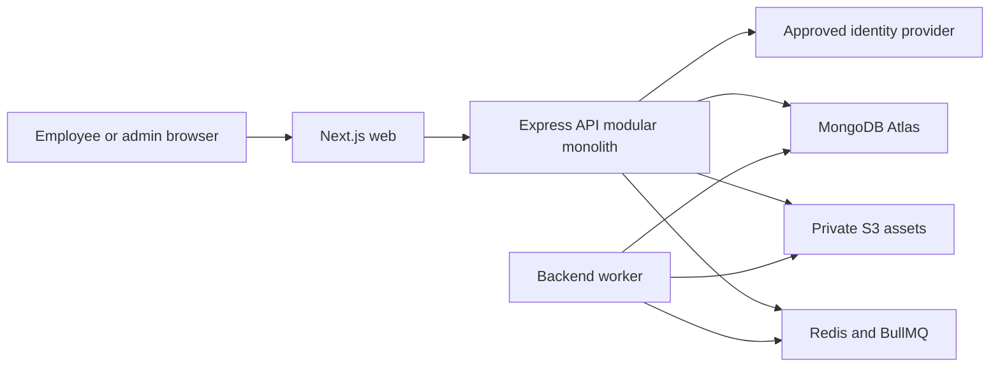

# System architecture

Phase 0 proposal · 28 October 2026

## Deployment and module boundaries

Use one repository with `frontend` (Next.js/TypeScript), `backend` (Express/TypeScript), and a worker entry point owned by the backend. Shared packages contain validated public DTOs, schema definitions and simulation input contracts; they must not expose answer keys, database models or secrets to the web build. Tailwind and shadcn/ui support the application shell; Three.js/React Three Fiber/Drei serve selected client-only simulations; Motion/SVG handle simpler interactions.

Use a same-origin reverse proxy for `/api/v1` where hosting permits. It simplifies cookie security and deployment networking; independent web/API processes retain ownership separation. Next.js renders presentation and may forward authenticated requests, but Express is the sole domain authorization and mutation boundary. Do not duplicate domain logic in Next route handlers or browser state. A worker is another process of the same backend deployment/version, not a microservice with a separate domain database.

| Backend module | Owns | Dependency rule |
|---|---|---|
| Identity and organization | Users, memberships, tree, role grants, sessions | Exposes actor/scope evaluation; no dependency on learning UI |
| Catalog and publishing | Drafts, versioned lessons/courses, approvals, publication | References approved asset and technical-policy versions |
| Learning | Enrollments, assignment audiences, progress, events | Uses published release manifests and scoped identity |
| Assessment | Sessions, question selection, immutable attempts, grading | Owns private answer keys; returns permitted feedback only |
| Simulation and competency | Config releases, runs, evaluated evidence, competency mappings | Uses approved parameters and evaluator versions |
| Certification | Policy evaluation, awards, expiry/revocation | Consumes authoritative completion evidence |
| Reporting and audit | Read models, exports, security/business audit | Cannot mutate attempt history or create learning evidence |
| Platform services | S3 access, outbox, queue, notifications, monitoring | Infrastructure adapters; business decisions stay in owning module |

Modules call typed services within the process rather than HTTP between modules. A module owns its collection writes. This gives a sole developer straightforward transactions and debugging while keeping future extraction possible. Trade-off: releases are coupled and boundary discipline must be enforced through imports and review.

## Identity, trust and security

Recommend enterprise OIDC single sign-on if available, with secure HTTP-only session cookies, CSRF protection for mutations, short session lifetime and revocation. Exact provider, MFA, employee directory and lifecycle integration require IT approval. Do not build a password system before that decision. Resolve a verified issuer/subject to an internal user; employee ID is a business attribute, not an authentication credential.

Backend derives actor, organization and effective scopes from trusted session/grant data. Deny by default; check action plus object scope, ownership, lifecycle and separation of duties. Filter list/aggregation/export queries before pagination, not after. Treat every identifier, content field, simulation payload and imported CSV as untrusted. Validate allowlisted schemas; prevent mass assignment and Mongo operator injection. Sanitize rich text and SVG; reject executable uploads and arbitrary iframe origins. Apply CSP, TLS, secure headers, explicit CORS, request/body limits, rate limits and redacted error handling. Secrets stay in a managed secret store and workload identities; no credentials in client bundles or Git.

Use private S3 buckets, encryption and narrowly scoped workload permissions. Upload to a generated quarantine key; validate size, checksum, actual format and malware status before marking usable. Use immutable asset keys and short-lived authorized reads. A presigned upload can overwrite an existing key, so reusing published keys is unsafe; see [AWS upload documentation](https://docs.aws.amazon.com/AmazonS3/latest/userguide/PresignedUrlUploadObject.html). Prevent publication until all referenced assets are ready.

## Consistency, publication and jobs

Use MongoDB single-document atomic changes for isolated state and short multi-document transactions for publication, final assessment submission, enrollment completion, certificate award and security-sensitive audit writes. MongoDB supports such transactions but documents their added cost; bounded aggregates avoid unnecessary cross-document work. See [MongoDB transactions](https://www.mongodb.com/docs/manual/core/transactions/).

Commit domain changes and an outbox row in one transaction. A dispatcher enqueues BullMQ jobs; workers use stable business deduplication keys and record durable completion before acknowledging. At-least-once delivery means duplicate execution must be harmless. Redis is not the record of learning truth. Retries use bounded exponential backoff, failure visibility and an audited replay path. Reconciliation finds pending outbox records, missing certificate renders and overdue reminders. [BullMQ's idempotency guidance](https://docs.bullmq.io/patterns/idempotent-jobs) supports this retry-safe approach. Extra outbox code is justified by avoiding lost certificates/reminders during outages; no event broker is needed.

Final grading and completion eligibility execute synchronously in the API transaction; document rendering, emails, large audience materialization and report exports run asynchronously. Certificate award existence is authoritative even while its downloadable rendering is pending.

## Operations and recovery

Separate development, staging and production configuration, credentials, buckets and databases. Use synthetic data outside production. Automate type checks, meaningful tests, dependency scans, build validation and reviewed deployment. Choose exact supported runtime/library versions during implementation; no package versions are prescribed by prototype imports.

Record request/correlation IDs, structured redacted logs, latency/error metrics, authorization denials, queue failures, outbox age, export age, storage failures and projection lag. Expose liveness/readiness independently; failed dependencies should fail readiness. Use controlled Mongo index/schema migrations with preflight, backups and rollback plans. Prefer expand/migrate/contract changes to destructive deployments.

Configure Atlas backups and point-in-time recovery appropriate to the approved tier, S3 versioning/lifecycle and protected audit exports. Define RPO/RTO, retention, residency, encryption-key recovery and restore owners with IT. Restore database, referenced asset versions and configuration to an isolated environment; reconcile outbox/jobs and certificates before reopening. Exercise recovery before pilot and periodically after release. Availability, backup features, network restrictions and hosting services remain decisions, not assumptions.

Avoid Kubernetes, service meshes, sharding and separate analytics infrastructure initially. Measure real concurrency, reporting cost and asset load before adding them. The architecture can scale stateless API/web instances and workers independently without splitting domains.
